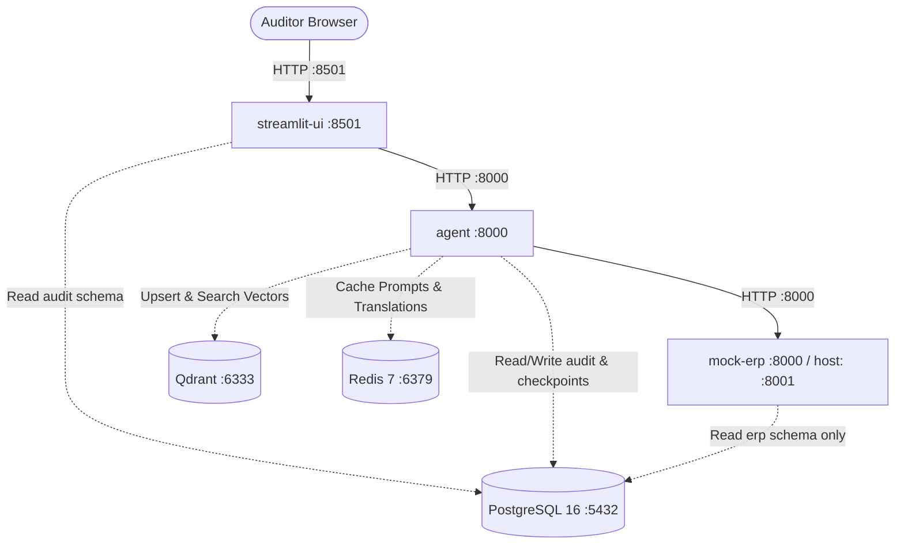

# AI Invoice Auditor
### A Containerized, Multilingual Invoice Validation & Auditing System

An enterprise-grade, agentic AI system running as a containerized multi-service application that monitors, ingests, translates, and audits multilingual vendor invoices against an internal ERP service backed by PostgreSQL. The system features a LangGraph workflow, a reflective RAG pipeline evaluated on the RAG Triad, and a human-in-the-loop Streamlit dashboard.

---

## 1. Solution Architecture

The system is deployed as six containerized services on a dedicated Docker bridge network (`invoice-net`). Services resolve each other by service name; no IP addresses or localhost references are hardcoded between containers.



### Service Map & Responsibilities

| Service | Image / Build | Ports (Host:Container) | Responsibility |
| :--- | :--- | :--- | :--- |
| **`agent`** | Custom Dockerfile | `8000:8000` | Runs the LangGraph workflow: Monitor, Extractor, Translation, Validation, Reporting, and RAG agents. Exposes FastAPI management endpoints. |
| **`mock-erp`** | Custom Dockerfile | `8001:8000` | Isolated FastAPI microservice serving PO, vendor, and SKU master lookups from PostgreSQL `erp` schema. |
| **`streamlit-ui`** | Custom Dockerfile | `8501:8501` | Human-in-the-loop web dashboard. Reads audit records and submits feedback and revalidation requests. |
| **`postgres`** | `postgres:16` | `5432:5432` | Durable system of record holding ERP master data, audit trail, and LangGraph checkpoints across three schemas. |
| **`qdrant`** | `qdrant/qdrant:v1.9.0` | `6333:6333` | Vector database for the RAG index. Fully derived and rebuildable from persisted PostgreSQL text. |
| **`redis`** | `redis:7-alpine` | `6379:6379` | Disposable in-memory cache for prompt hashes (`llm:{sha256}`) and translations. |

---

## 2. Core Architectural Design Decisions

1. **Agent Writes Exclusively:** The `agent` container is the only service that writes audit data. `mock-erp` only reads the `erp` schema, and `streamlit-ui` only reads the `audit` schema (with insertions into `human_feedback`).
2. **Strict ERP Service Boundary:** Both the agent and UI can physically reach PostgreSQL, but neither is permitted to query the `erp` schema directly. All ERP data must be fetched through `http://mock-erp:8000/po/{po_number}`.
3. **Qdrant Derived From PostgreSQL:** Vector embeddings are derived strictly from raw text stored in PostgreSQL. If the Qdrant volume is wiped, running the index rebuild regenerates all vectors without repeating expensive OCR or re-reading PDFs.
4. **Redis Disposable by Design:** Caches only values that can be safely recomputed. Agent state, audit records, and the vector index have durable homes elsewhere.
5. **Non-Destructive Human Corrections:** Corrections submitted in Streamlit are recorded as new rows in `audit.human_feedback`, never overwriting original extracted values.

---

## 3. Technology Stack & Model Selection

- **Agent Orchestration:** LangGraph, LangChain (`langchain_aws`)
- **LLM Engine:** AWS Bedrock via `ChatBedrockConverse`
  - **Reasoning & Summarization:** Amazon Nova Lite (`amazon.nova-lite-v1:0`)
  - **Multilingual Translation:** Cohere Command R+ (`cohere.command-r-plus-v1:0`)
  - **RAG Generation:** Cohere Command R+ (`cohere.command-r-plus-v1:0`)
- **Vector Embeddings:** Amazon Titan Embed Text v2 (`amazon.titan-embed-text-v2:0`) via `BedrockEmbeddings`
- **OCR & Document Extraction:** `pdfplumber` (direct extraction), Poppler utilities, `pytesseract` (Tesseract with `eng`, `deu`, and `spa` language packs), `python-docx`
- **API Framework:** FastAPI, Uvicorn, Pydantic v2
- **Persistence & Caching:** PostgreSQL 16 (Relational), Qdrant v1.9 (Vector), Redis 7 (Cache)
- **User Interface:** Streamlit (Multi-page dashboard)

---

## 4. Directory Structure

```text
Capstone_Project/
├── compose.yaml                  # Root Docker Compose specification
├── docker-compose.yml            # Compatibility link
├── .env.example                  # Environment template
├── .gitignore                    # Secrets & build ignore rules
├── README.md                     # Comprehensive documentation
├── slides.md                     # 5-Slide presentation
├── config/
│   ├── rules.yaml                # Business & mathematical audit rules
│   └── personas.yaml             # Agent persona prompts & RAG templates
├── data/
│   ├── ERP_mockdata/             # PO Records.json, sku_master.json, vendors.json
│   └── incoming/                 # Incoming invoices (PDF, DOCX, PNG) & meta.json
├── db/
│   ├── init.sql                  # Automated Postgres startup seed script
│   ├── erp_schema.sql            # Master ERP schema
│   └── audit_schema.sql          # Durable Audit schema
├── mock_erp/
│   ├── Dockerfile                # Pinned python:3.11-slim, non-root user
│   ├── requirements.txt
│   └── app/
│       ├── main.py               # FastAPI endpoints (/po, /vendor, /sku)
│       ├── database.py           # PostgreSQL query layer
│       └── models.py             # Pydantic schema models
├── agent/
│   ├── Dockerfile                # Pinned python:3.11-slim, Tesseract OCR + Poppler
│   ├── requirements.txt
│   └── app/
│       ├── main.py               # FastAPI server (/process, /revalidate, /query)
│       ├── config.py             # Pydantic Settings & rules loader
│       ├── db.py                 # Audit persistence repository
│       ├── cache.py              # Redis LLM & translation caching
│       ├── llm/
│       │   ├── bedrock.py        # ChatBedrockConverse & BedrockEmbeddings wrapper
│       │   └── prompts.py
│       ├── extractors/
│       │   ├── router.py         # Routing & SHA-256 deduplication
│       │   ├── pdf_extractor.py  # pdfplumber + OCR fallback
│       │   ├── docx_extractor.py # python-docx parser
│       │   └── image_extractor.py# pytesseract OCR
│       ├── workflow/
│       │   ├── state.py          # LangGraph InvoiceState
│       │   ├── nodes_monitor.py
│       │   ├── nodes_extractor.py
│       │   ├── nodes_translation.py
│       │   ├── nodes_validation.py
│       │   ├── nodes_reporting.py
│       │   └── graph.py          # Compiled LangGraph workflow
│       └── rag/
│           ├── vector_store.py   # Qdrant client
│           ├── indexing.py       # Chunking, embedding, and vector upsert
│           ├── state.py          # RAG state definition
│           ├── reflection.py     # RAG Triad judge
│           └── graph.py          # Reflective RAG graph with retry loop
└── streamlit_ui/
    ├── Dockerfile                # Pinned python:3.11-slim, non-root user
    ├── requirements.txt
    └── app/
        ├── main.py               # Streamlit application
        ├── db.py                 # PostgreSQL read layer
        └── api_client.py         # HTTP client calling agent:8000
```

---

## 5. Getting Started & Configuration

### Step 1: Clone and Configure Environment
Copy the `.env.example` file to `.env`:
```bash
cp .env.example .env
```

Edit `.env` with your preferred settings and AWS credentials:
```env
# Database Settings
POSTGRES_DB=invoicedb
POSTGRES_USER=postgres
POSTGRES_PASSWORD=postgres

# AWS Bedrock Authentication
AWS_REGION=us-east-1
AWS_ACCESS_KEY_ID=your_access_key_here
AWS_SECRET_ACCESS_KEY=your_secret_key_here
AWS_SESSION_TOKEN=

# Model Identifiers
MODEL_REASONING=amazon.nova-lite-v1:0
MODEL_RAG_GENERATION=cohere.command-r-plus-v1:0
MODEL_TRANSLATION=cohere.command-r-plus-v1:0
MODEL_EMBEDDING=amazon.titan-embed-text-v2:0
```
*(Note: If AWS credentials are not configured, the system gracefully falls back to deterministic domain responses, ensuring the full containerized workflow can be tested without errors).*

### Step 2: Start the Complete Stack
Run a single command to build and launch all six services:
```bash
docker compose up --build -d
```

Verify that all six services report healthy:
```bash
docker compose ps
```

---

## 6. Verification Checklist (Step-by-Step)

### Check 1 — Single-Command Startup
Test clean recreation from scratch:
```bash
docker compose down -v
docker compose up --build -d
docker compose ps
```
**Expected Outcome:** All 6 containers (`agent`, `mock-erp`, `streamlit-ui`, `postgres`, `qdrant`, `redis`) are running and report healthy status within 30 seconds.

---

### Check 2 — End-to-End Invoice Processing
1. Trigger processing of invoices in `/data/incoming`:
   ```bash
   curl -X POST http://localhost:8000/process -H "Content-Type: application/json" -d "{}"
   ```
   *Or navigate to the Streamlit UI at `http://localhost:8501` and click **"Scan Incoming Folder"**.*
2. Confirm outcomes in PostgreSQL:
   ```bash
   docker compose exec postgres psql -U postgres -d invoicedb -c "SELECT invoice_number, vendor_name, recommendation, total_amount FROM audit.invoice_audit;"
   ```
3. Open `http://localhost:8501` to view the **Audit Dashboard** and inspect discrepancies.

---

### Check 3 — Persistence Across Restart
Demonstrate that audit history and vector indices survive container teardown:
1. Ensure at least one invoice is processed (from Check 2).
2. Destroy containers while retaining named volumes:
   ```bash
   docker compose down
   ```
3. Re-launch the stack:
   ```bash
   docker compose up -d
   ```
4. Query the database and test RAG without reprocessing anything:
   ```bash
   docker compose exec postgres psql -U postgres -d invoicedb -c "SELECT count(*) FROM audit.invoice_audit;"
   ```
5. In Streamlit (`http://localhost:8501`), go to **RAG Assistant** and ask:
   *"Why was invoice INV-1004 flagged?"*
**Expected Outcome:** Data and vector search results remain fully intact.

---

### Check 4 — Deliberate Data Loss
Demonstrate the difference between retaining and deleting named volumes:
1. Destroy the stack along with named volumes:
   ```bash
   docker compose down -v
   ```
2. Re-launch the stack:
   ```bash
   docker compose up -d
   ```
3. Verify that the audit trail is empty:
   ```bash
   docker compose exec postgres psql -U postgres -d invoicedb -c "SELECT count(*) FROM audit.invoice_audit;"
   ```
**Expected Outcome:** Count returns `0`. The `-v` flag destroyed the Docker named volumes (`postgres_data`, `qdrant_data`), proving that persistence in Check 3 was due to durable volumes.

---

### Check 5 — No Secrets in Built Images
Verify that no credentials, `.env` files, or private keys are baked into any Docker image layer:
```bash
docker history invoice-agent:1.0 --no-trunc
docker history invoice-mock-erp:1.0 --no-trunc
docker history invoice-streamlit-ui:1.0 --no-trunc
```
**Expected Outcome:** No environment keys, passwords, or `.env` file contents appear in any build layer.

---

### Check 6 — Service-Name DNS Resolution
Verify that services communicate exclusively via Docker service names over the bridge network:
```bash
docker compose exec agent getent hosts postgres
docker compose exec agent getent hosts mock-erp
docker compose exec agent getent hosts qdrant
docker compose exec agent getent hosts redis
```
**Expected Outcome:** Each command successfully resolves the internal container IP on the `invoice-net` network.

---

## 7. RAG Pipeline & RAG Triad Reflection

The RAG pipeline operates over chunked raw invoice text and synthesized audit reports in Qdrant:
1. **Indexing Agent:** Chunks documents with `RecursiveCharacterTextSplitter`, embeds them with Amazon Titan, and stores metadata payloads (`invoice_id`, `vendor`, `source_type`, `language`).
2. **Retrieval Agent:** Semantic vector search supporting optional filters by `invoice_id` or `vendor`.
3. **Augmentation Agent:** Assembles context chunks.
4. **Generation Agent:** Produces factual responses via Cohere Command R+. Checks Redis cache (`llm:{sha256(prompt)}`) first.
5. **Reflection Agent (RAG Triad):** Evaluates:
   - **Context Relevance:** Are retrieved chunks relevant to the user query?
   - **Groundedness:** Are all claims substantiated by the context?
   - **Answer Relevance:** Does the answer directly address the question?
   - **Quality Gate:** If `average_score >= 0.70`, the answer is delivered. If `< 0.70`, the pipeline automatically reforms the query and expands retrieval depth (up to 3 retries).

---

## 8. Web Dashboard Features (`http://localhost:8501`)

- **Audit Dashboard:** Metric KPI cards, interactive table, status badges (`APPROVE`, `REVIEW`, `REJECT`), and filters.
- **Invoice Deep Dive:** Discrepancy details table, PO matching breakdown, side-by-side raw vs. translated text.
- **Human-in-the-Loop Review:** Field correction form that writes to `audit.human_feedback` and triggers re-validation via `POST /revalidate`.
- **RAG Assistant:** Natural language question-and-answer interface with live RAG Triad metrics display.
- **System Topology:** Real-time health monitors for all 6 containers.
